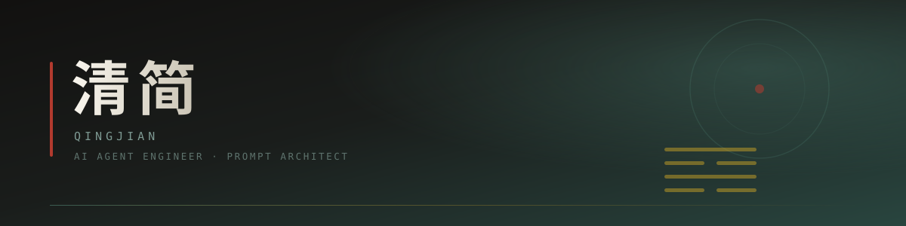

  

  

 

## 你好，我是清简

我在昆明，写 Agent，也读古书。

白天调 Prompt、接工具、搭记忆系统；晚上翻《周易》、看注疏、抄几句。这两件事看上去隔得很远，其实是同一件事——都在琢磨「怎么让一个东西有条理地思考」。

国学给我的不是素材，是**结构感**。阴阳是二值判断，五行是状态机，卦变是状态转移，义理是解释层。把这些翻译成 Prompt 的结构，比堆一屏形容词有用得多。

> 写代码是给机器立规矩，读古书是给人立规矩，最后都是同一门手艺。

## 现在在做

- **给 Agent 装脑子** —— [mingsi-skills](https://github.com/qingjian0/mingsi-skills)（明思）、[qiushi-skill](https://github.com/qingjian0/qiushi-skill)（求是）、[Sharp-skill](https://github.com/qingjian0/Sharp-skill)：把「怎么想问题」拆成可复用、可组合的 Skill，而不是一段越写越长的 System Prompt
- **让古籍可以被推理** —— [mingli-ai](https://github.com/qingjian0/mingli-ai)（明理）、[Tianwen](https://github.com/qingjian0/Tianwen)（天问）、[shushu-knowledge-base](https://github.com/qingjian0/shushu-knowledge-base)：结构化知识库 + 推理链，让模型引用典籍时有据可依
- **造自己顺手用的工具** —— [dsh-workbench](https://github.com/qingjian0/dsh-workbench)（本地工具与协议复刻车间）、[dsh-android](https://github.com/qingjian0/dsh-android)（把 Agent 塞进手机）

## 工具箱

  

  
  
  
  
  
  
  

## 精选项目

<table width="100%">
<tr>
<td width="50%" valign="top">

**[dsh-workbench](https://github.com/qingjian0/dsh-workbench)** 
本地工作台：自研 skill 与协议复刻。第一个成品是酷安客户端——离线签发 `X-App-Token` v3，纯 HTTP 读写社区数据，不装 App、不登录、不解 TLS。 
`JavaScript` · `逆向`

</td>
<td width="50%" valign="top">

**[mingsi-skills](https://github.com/qingjian0/mingsi-skills)** 
明思技能包——把 System Prompt 的设计与优化拆成可复用的结构化技能，让 Agent 先想清楚再动笔。 
`Prompt Engineering` · `Skill`

</td>
</tr>
<tr>
<td width="50%" valign="top">

**[shared-memory-skill](https://github.com/qingjian0/shared-memory-skill)** 
跨工具共享长期记忆：MCP 协议 + FTS5 全文检索 + 向量召回，Claude Code / Codex / Cursor 共用一个记忆库。 
`MCP` · `Python` · `RAG`

</td>
<td width="50%" valign="top">

**[qiushi-skill](https://github.com/qingjian0/qiushi-skill)** 
求是——从经典唯物辩证法与实践哲学里提炼出总原则和九大方法论，装进 AI 的决策回路。 
`Methodology` · `Skill`

</td>
</tr>
<tr>
<td width="50%" valign="top">

**[mingli-ai](https://github.com/qingjian0/mingli-ai)** 
明理——基于古籍经典的 AI 命理智能推理平台。不是查表套模板，而是让模型沿推理链给出依据。 
`Python` · `国学` · `LLM`

</td>
<td width="50%" valign="top">

**[Tianwen](https://github.com/qingjian0/Tianwen)** 
天问——AI 易学命理分析与推理系统，把卦爻辞、象数与现代推理链对齐。 
`易学` · `推理`

</td>
</tr>
<tr>
<td width="50%" valign="top">

**[dsh-android](https://github.com/qingjian0/dsh-android)** 
把 AI Agent 塞进手机：KMP + Compose Multiplatform，让 Harness 原生跑在 Android 上。 
`Kotlin` · `Android`

</td>
<td width="50%" valign="top">

**[teaching-well](https://github.com/qingjian0/teaching-well)** 
教案精灵——按 2022 课程标准生成教案的 AI 工具，给一线老师省下的是备课的那几个小时。 
`HTML` · `教育`

</td>
</tr>
</table>

## 数据

  

  

  
  
  

## 最近写的

<!-- BLOG-POST-LIST:START -->
- [构建跨工具共享记忆系统：MCP 协议与 FTS5 + 向量混合检索架构深度解析](https://qingjian0.github.io/blog/mcp-memory-shared)
- [求是方法论在 AI Agent 中的应用：从唯物辩证法到 Prompt Engineering](https://qingjian0.github.io/blog/qiushi-methodology)
- [Sharp Think — 结构化思考优化 Agent Skill 设计与实践](https://qingjian0.github.io/blog/structured-thinking-agent)
- [明思技能包——AI 智能体 System Prompt 设计与优化实战指南](https://qingjian0.github.io/blog/mingsi-prompt-skills)
<!-- BLOG-POST-LIST:END -->

## 每天一句

> **「道生一，一生二，二生三，三生万物」**
> *—— 《道德经》*
>
> 从简单规则涌现复杂智能行为

  

  
  
  

  清简 · 昆明 · 写代码也读古书

